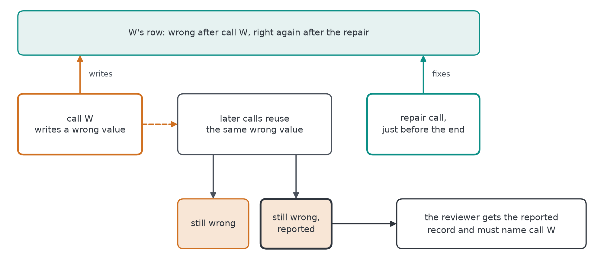
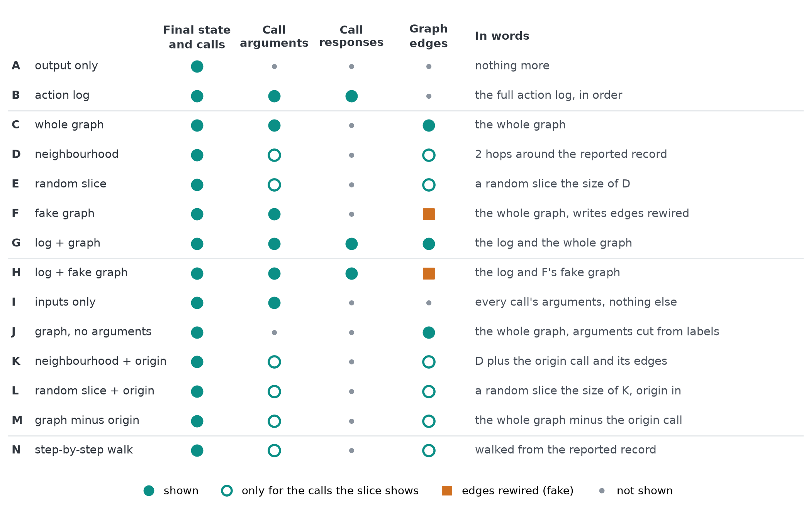
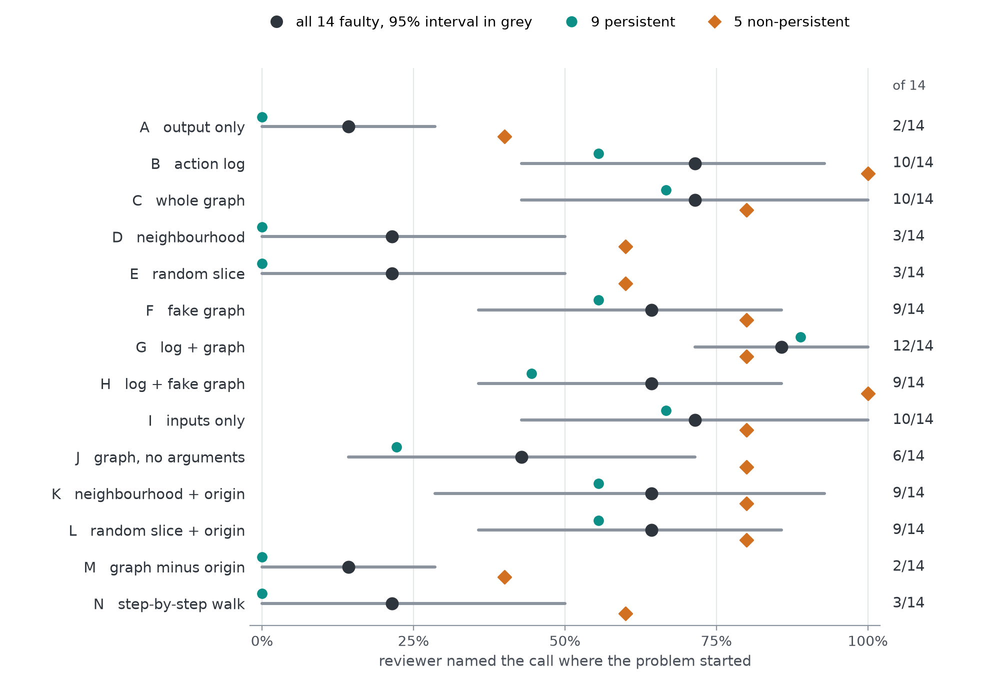
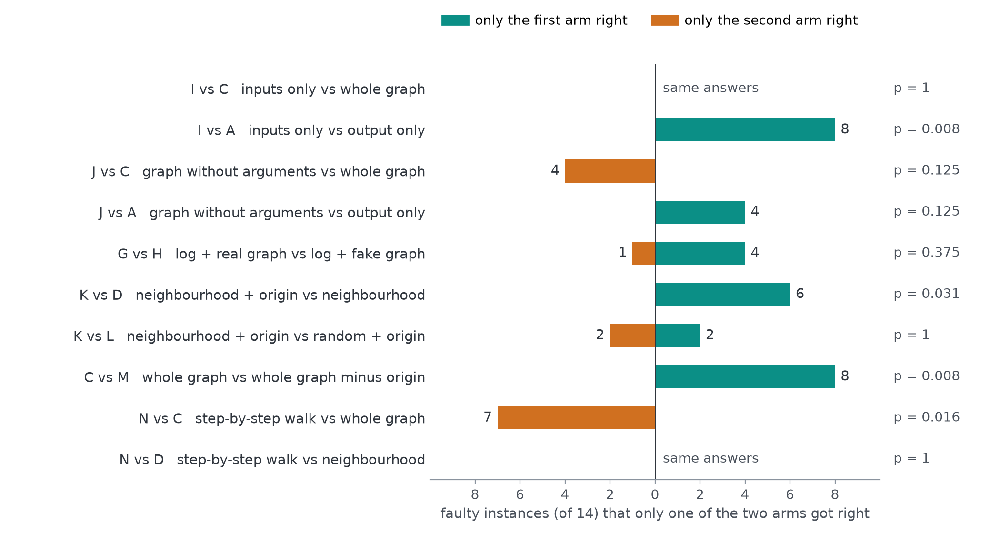
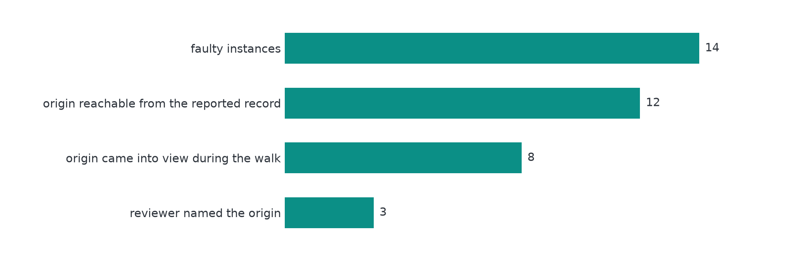

# Control arms and a step-by-step reviewer, 6 Nov 2026

This follows your notes on the pilot. Six control arms (H to M) answer your points 2 and 3, and arm N is a reviewer that walks the graph one node at a time, for your question of 2 Nov about whether the model takes the whole graph or parses it step by step.

Everything ran on the same 23 frozen instances as the [pilot](../pilot-2026-11-02/README.md): 9 persistent faults, 5 non-persistent faults and 9 clean twins from 7 AppWorld generators. The reviewer is the same, `claude-haiku-5-5` at effort medium through an isolated `claude -p`, with one review per arm and instance. The controls took 138 calls and the walks 122, and none failed. Arms A to G are the pilot's own reviews, not re-run.

With 14 faulty instances from 7 generators, all of this is direction, not proof.

## In short

- **Inputs are enough in one shot.** Call inputs alone (arm I: each call's arguments, no responses, no graph) find the origin in 10 of 14, the same as the whole graph (C) and the full log (B). I and C name the same call on all 14 faulty instances, so what the graph arm gets right comes from the arguments printed in its node labels.
- **Structure alone helps a little.** The whole graph with the arguments cut out (J) gets 6 of 14, more than output only (A, 2 of 14) and less than C. Every instance J loses against C is a persistent fault (2 of 9 against 6 of 9).
- **The slice arms depend on whether the origin is in the evidence.** Forcing the origin call into the 2-hop neighbourhood takes it from 3 of 14 to 9 of 14 (K against D). A random slice with the origin in does exactly as well (L, 9 of 14). Taking the origin out of the whole graph drops it to 2 of 14, the output-only level (M against C).
- **The graph adds to the log only when its edges are real, and only on persistent faults.** Log plus real graph (G) gets 8 of 9 persistent faults, log plus fake graph (H) 4 of 9.
- **Walking does not help Haiku here.** The step-by-step reviewer (N) finds the origin in 3 of 14, the same instances as the plain neighbourhood, and none of the 9 persistent faults. It stopped by its own choice in 20 of 23 walks, after a median of 3 expanded nodes.

## The fault

**Figure 1.** In a persistent fault, call W writes a wrong value and later calls reuse the same wrong value, so the records they build are wrong too. A repair just before the end puts W's own row right, but the records built from the wrong value stay wrong. The reviewer is told that one of them looks wrong and must name W. A non-persistent fault has no repair. In a clean twin the repair comes straight after W, so nothing is built from the wrong value.

## What each arm sees

**Figure 2.** Every arm gets the task, the agent's final message, the user's report, the final state of the records the agent changed and the list of calls by index and API. The columns show what else it gets. Arms A to M get everything in one prompt with no tools; arm N walks the graph (below).

## Results

**Figure 3.** How often each arm named the call where the problem started. The black dot is all 14 faulty instances with a 95% interval from a bootstrap over generators; the teal and orange marks split it into persistent and non-persistent faults.

| Arm | Evidence | Origin found, faulty (14) | Persistent (9) | Non-persistent (5) | False alarm on clean (9) |
|---|---|---|---|---|---|
| A | output only | 2 of 14 | 0 of 9 | 2 of 5 | 4 of 9 |
| B | action log | 10 of 14 | 5 of 9 | 5 of 5 | 1 of 9 |
| C | whole graph | 10 of 14 | 6 of 9 | 4 of 5 | 5 of 9 |
| D | neighbourhood | 3 of 14 | 0 of 9 | 3 of 5 | 1 of 9 |
| E | random slice | 3 of 14 | 0 of 9 | 3 of 5 | 3 of 9 |
| F | fake graph | 9 of 14 | 5 of 9 | 4 of 5 | 2 of 9 |
| G | log + graph | 12 of 14 | 8 of 9 | 4 of 5 | 2 of 9 |
| H | log + fake graph | 9 of 14 | 4 of 9 | 5 of 5 | 1 of 9 |
| I | inputs only | 10 of 14 | 6 of 9 | 4 of 5 | 2 of 9 |
| J | graph, no arguments | 6 of 14 | 2 of 9 | 4 of 5 | 4 of 9 |
| K | neighbourhood + origin | 9 of 14 | 5 of 9 | 4 of 5 | 4 of 9 |
| L | random slice + origin | 9 of 14 | 5 of 9 | 4 of 5 | 1 of 9 |
| M | graph minus origin | 2 of 14 | 0 of 9 | 2 of 5 | 2 of 9 |
| N | step-by-step walk | 3 of 14 | 0 of 9 | 3 of 5 | 4 of 9 |

False alarms are clean twins where the reviewer claimed wrong records. They are highest for the whole graph (C, 5 of 9) and lowest for the log (B), the neighbourhood (D), log plus fake graph (H) and the random slice with the origin (L), all 1 of 9.

**Figure 4.** Each row pairs two arms on the same 14 faulty instances and counts the instances only one of them got right. The p value is an exact two-sided sign test on those counts. It is descriptive: instances within a generator are not independent, and nothing is corrected for multiplicity. Inputs only and the whole graph give the same answers (I vs C); removing the origin costs the whole graph 8 instances (C vs M, p = 0.008); adding it to the neighbourhood gains 6 (K vs D, p = 0.031).

## The step-by-step reviewer (arm N)

Arm N starts from the reported record with that record's edges shown. Each round it can expand one node it can see, a call or a record, to reveal that node's edges and neighbours, for up to 6 rounds, and it can stop at any time. Each round is a fresh isolated call that sees the same header as every arm, the part of the graph explored so far, its own notes from earlier rounds (up to 600 characters each) and any request that could not be done. It then answers through the same prompt and schema as every other arm, over the explored part only, so it is scored the same way. The graph it walks is byte for byte the graph arm C shows.

**Figure 5.** Where the walk loses the origin, over the 14 faulty instances. In 2 of them the reported record has no path to the origin in the graph, so no walk can get there. In the other 12 the origin call came into view in 8, and the reviewer named it in 3 of those. When it was in view and missed, the reviewer named another call in 3 and no call in 2.

So reaching the origin is only part of the problem: once it is on screen as a neighbour, Haiku often still does not pick it. Your nested-graph result may need a stronger model or a walk the reviewer cannot stop early. That second version is implemented as arm O (it must use all 6 expansions) but has not been run.

## Runtime errors (your point 6): a first probe

All pilot faults are code errors in your sense: the agent passes a wrong argument. As a first runtime error, the probe changes what the code sees in one read call's response. A value is swapped for another value of the same field from the same list (another contact, another transaction), while every line of code stays right and writes the value on.

Of 130 candidate read calls from 13 generators, 31 runs finished and left two or more wrong rows, from 8 generators (7 of them not used by the pilot). In 70 runs the swapped value made a later API call fail. At two instances per generator that is about 12 more instances outside the pilot set, enough for a code-versus-runtime split but not enough on its own for the main run.

Four decisions are yours before it becomes a fault family:

1. Whether the origin is the read call that returned the wrong value or the first write that used it.
2. Whether the trace shows the wrong response, as if the service returned it. Today the probe changes only what the code sees, so the trace shows the right response and a write that does not match it.
3. What the repair is, for example fixing the first record built from the wrong value while the later ones stay wrong.
4. What the clean twin is, since there is no held value to cut off early.

## Caveats

- 14 faulty instances from 7 generators, at most 2 per generator.
- All persistent faults are held-value faults: the agent keeps a wrong value across calls, so the wrong value does not travel through an API edge.
- One model and one review per arm. In the pilot, Haiku named the same origin in all 4 runs of the whole-graph view for only 2 of 10 instances.
- Arm N's design is one of several reasonable ones: separate rounds that share notes, at most 6 expansions, and an answer over the explored part only.

## Next

- Run arm O, the walk that must use every expansion, to see whether walking helps when the reviewer cannot stop early.
- Your four decisions on runtime errors, then build that family next to the code-error one.
- More instances: these results rest on 14 faulty instances, and the main analysis needs several times that.

## Files

- `scores.jsonl`: 322 rows, one per instance and arm (A to N), metrics and ids only, no AppWorld data. Arm N rows add the walk: rounds, nodes expanded, how it stopped, whether the origin came into view or was expanded, and its distance from the reported record.
- `runtime_probe.json`: the probe's counts.
- `figures/`: drawn by `src/rdr/share.py` from the saved reviews; every number in this README is computed there too.
- Full tables: [`docs/controls_results.md`](../../docs/controls_results.md) and [`docs/stepwise_results.md`](../../docs/stepwise_results.md).
- Rerun from the repo root with `PYTHONPATH=src .venv/bin/python -m` and `rdr.controls derive|run|analyse`, `rdr.stepwise run|analyse`, `rdr.runtime_probe` and `rdr.share`.
